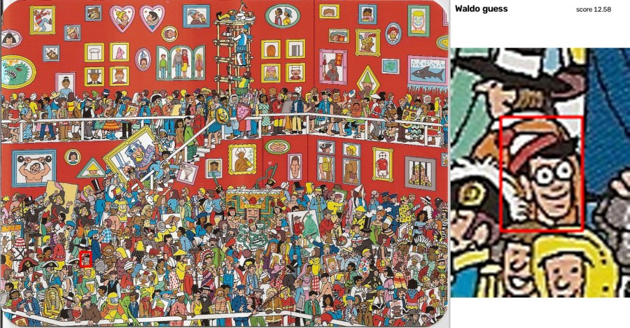
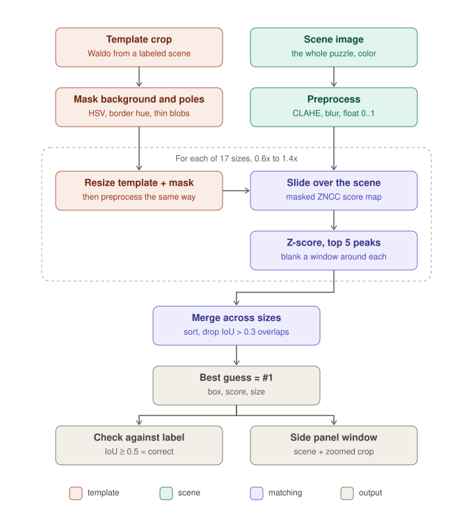
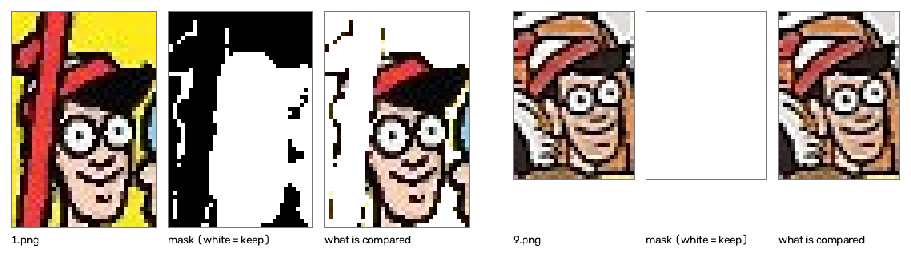
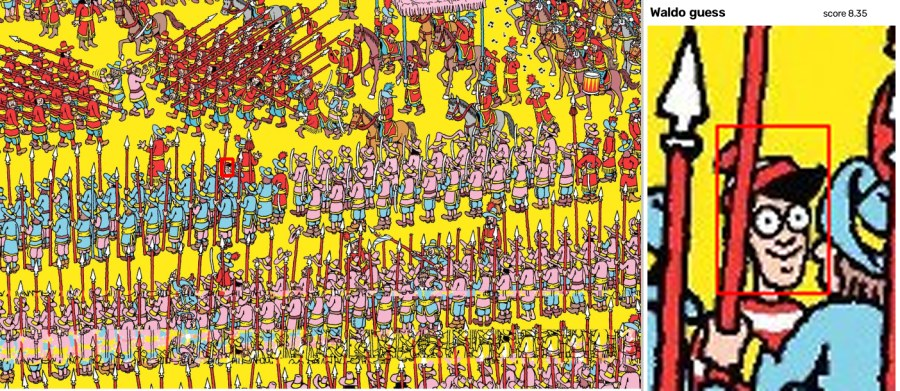

# Where's Waldo Finder

A small Waldo finder built on one idea: slide a picture of Waldo over the
whole page, score how well it fits at every spot, and box the best one.
No machine learning. One file to run. OpenCV and NumPy only.



*Page 9. Red is the finder's guess, green is where Waldo really is, and the
panel on the right is the guess zoomed in with its score.*

[Background](#background) ·
[Problem statement](#problem-statement) ·
[Approach](#approach) ·
[Results](#results) ·
[Quick start](#quick-start) ·
[Layout](#layout) ·
[Limits](#limits) ·
[Ethical implications](#ethical-implications) ·
[References](#references)

## Background

*Where's Wally?* is a series of picture books by the British illustrator
Martin Handford. The first one came out in 1987, and the American edition
renamed the character Waldo. Every page is a crowded drawing of hundreds of
tiny people at a beach, a train station, a battlefield, and somewhere in
the crowd is Waldo: a thin man in a red and white striped shirt, a red and
white bobble hat and round glasses. The game is to find him.

The books are designed to make that hard. Waldo is drawn very small, often
under half an inch tall. The crowd is full of people in red and white
clothes, striped shirts and red hats. He is usually half hidden behind
someone, a pole or the edge of a tent. People can spend minutes on one
page.

That mix is what makes it a good project for an image processing class.
We know exactly what we are looking for, because we have a picture of him,
so no large training set is needed. At the same time the page is built to
fool pattern matching, so the plain version of each technique fails and
has to be improved step by step. And it is easy to check the answer: open
the page and look.

## Problem statement

Can a program find Waldo on a page it has never seen?

Given a full page and a small cut-out of Waldo taken from a different
page, draw one box around Waldo. The box is right if it lands on him,
which we define as overlapping the hand-drawn answer box by at least half
(the usual rule in object detection, called intersection over union or
IoU).

Rules I set for the project:

- Plain image processing only. No training and no neural networks.
- One file to run, short enough to read in an afternoon.
- A full page should take seconds on a laptop.
- The real test uses a cut-out from a different page. A cut-out taken
  from the page being searched always matches itself perfectly, so that
  result says nothing.

## Approach



Each step in plain words. The code for steps 2 to 7 is in `waldo/`, and
`find_waldo.py` runs them in order. A more technical version of the
diagram, with the OpenCV names, is in
[docs/pipeline_detailed.svg](docs/pipeline_detailed.svg).

**1. What we start with.** A small cut-out of Waldo's head and hat
(the "template") and the page to search. Both stay in color because the
red and white stripes are the main clue.

**2. Clean up the cut-out.** The cut-out was snipped straight out of a
page, so it has things in it that are not Waldo: yellow background in the
corners and, on page 1, a spear across his face. The program finds the
main color along the cut-out's edge and treats it as background, and finds
any tall thin streak of strong color and treats it as a pole. Those pixels
get a "skip me" mark called a mask. The picture below shows the two
cut-outs, their masks and what is left to compare.



*Left: cut-out 1 with the yellow background and the spear masked out.
Right: cut-out 9 has neither, so all of it is kept.*

**3. Even out the page.** Two pages drawn with different inks or scanned
differently should still be comparable, so the page gets two small fixes.
First the contrast is evened out separately in each small tile of the
image, so a dim corner and a bright corner end up looking alike. The
technique is called CLAHE, short for contrast limited adaptive histogram
equalization; "adaptive" means per tile, "limited" means it will not
over-boost flat areas. Then a light blur (5 by 5 pixels) softens the
drawing so tiny pen strokes do not count. The cut-out gets the same
two fixes so the two images are on equal terms.

**4. Try many sizes.** Waldo is bigger on some pages than others. The
cut-out is resized from 0.6 times to 1.4 times its original size in 17
steps, and each size is tried in turn.

**5. Slide and score.** At each size the cut-out is laid over every
position on the page and compared with the patch underneath it. The
comparison first subtracts the average brightness of each patch and
divides by how spread out its values are, so a match is about the pattern
of stripes, glasses and hat and not about how light or dark the area is.
Masked pixels are left out of the sum. This measure is called zero-mean
normalized cross-correlation (ZNCC). OpenCV computes it for every position
at once, so the result is a score map the size of the page.

**6. Keep the best spots.** Score maps from different sizes are not on the
same scale, so each map is converted to "how many standard deviations
above this map's average". A score of 4.5 means the spot is 4.5 standard
deviations better than a typical spot on that page. The 5 highest spots
per size are kept. After each one is taken, a cut-out-sized window around
it is blanked out so the next pick is a different place and not the same
spot shifted by a pixel.

**7. Pick one.** All spots from all sizes and all cut-outs are sorted by
score. Any spot that overlaps a better one is dropped. The top spot is
the answer: a box, a score and the size it was found at.

**8. Show it.** The page opens in a window with the guess in red and, if
the page has a hand-drawn answer, that box in green. The right side of the
window is the guess zoomed in. The program also prints the box, the score
and whether the guess was right.

### What was tried first

An earlier version of this repository (still on `main` at commit 3040bd5)
compared four scoring measures written from scratch, three color spaces,
edge maps and a red/white color filter, in a grid search of 240 settings
on small crops. Three things came out of it. Plain cross-correlation
fails, because any bright patch scores well whether or not it looks like
Waldo, so the score has to be normalized. When the cut-out comes from a
different page, the best setting was ZNCC on color with the contrast fix
and the blur. And on full pages nothing worked until the mask was added:
the spear and the yellow corners in cut-out 1 were dragging every
comparison down. The settings that did not help were removed so the code
stays small.

## Results

Two pages are labeled so far, 1.jpg and 9.jpg, with one cut-out taken
from each. Each page was searched two ways: with both cut-outs available,
and the honest way, with only the cut-out from the other page.

| Page | Cut-outs used | Found by | Score | Overlap with answer | Right? | Time |
|---|---|---|---|---|---|---|
| 1.jpg | both | 1.png (its own) | 8.35 | 1.00 | yes | 19.8 s |
| 1.jpg | 9.png only | 9.png | 5.74 | 0.76 | yes | 9.5 s |
| 9.jpg | both | 9.png (its own) | 12.58 | 1.00 | yes | 9.2 s |
| 9.jpg | 1.png only | 1.png | 4.53 | 0.76 | yes | 4.6 s |

Waldo is the first guess on both pages in both settings. The second and
fourth rows are the ones that count: a cut-out from one page finds Waldo
on a page it came nowhere near, at a different size (0.80 times on page 9,
1.35 times on page 1), with a lower score that is still the best on the
page. Times are on a laptop CPU.



*Page 1 is the harder one. Waldo is tiny, surrounded by hundreds of
soldiers in red and blue, with a spear in front of his face. The red guess
sits on the green answer.*

On page 9 with only cut-out 1, the winning spot scored 4.53 and the
runner-up 4.15. That gap is real but small, and a page with a better
decoy could flip it. See Limits.

Two labeled pages is a demonstration, not a benchmark. The other 17 pages
in `data/original` have no answer box yet. Labeling them takes about a
minute each with the labeler script and would give a real accuracy
number.

## Quick start

```bash
python3 -m venv .venv
source .venv/bin/activate
pip install -r requirements.txt

python find_waldo.py                       # searches the page named at the top of the file
python find_waldo.py path/to/any_page.jpg  # or any image you like
```

A window opens with the result. Press any key to close it. Add `--no-show`
to print the box without a window.

`find_waldo.py` is the only file you run. It tries every cut-out in
`data/templates` and keeps the single best-scoring box. When the page is
one of the labeled ones it also prints `CORRECT` or `WRONG`.

## Layout

```
find_waldo.py             the one file to run
waldo/matcher.py          evening out, sliding at many sizes, scoring, box overlap
waldo/template_mask.py    mask out background and poles in the cut-out
waldo/visualize.py        result window with the zoomed side panel
scripts/label_waldo.py    drag a box around Waldo on a new page
scripts/make_templates.py cut templates out of the labeled pages
data/original/            full pages (Hey-Waldo dataset, see data/original/SOURCE.md)
data/labels.json          Waldo's box on each labeled page
data/templates/           the cut-outs, what the finder knows
docs/                     diagrams, the cut-out strip and the example images
```

### Adding a page

```bash
python scripts/label_waldo.py 5.jpg      # drag a box around his head and hat
python scripts/make_templates.py         # writes data/templates/5.png
python find_waldo.py data/original/5.jpg # now searched with all cut-outs
```

## Limits

The finder looks for things that look like the cut-out. It struggles when
Waldo is mostly hidden, drawn from an unusual angle, or when another
striped figure is a closer match at some size. The search is also brute
force, 17 sizes times every pixel times every cut-out, so time grows with
page size and the number of cut-outs. If a new page fails, the simplest
fix is to label one more page and cut its template: every cut-out in the
folder is tried automatically.

## Ethical implications

Finding one small figure in a crowded picture is the same problem as
finding one person in a crowd photo or a security camera frame. Template
matching is far too weak to do that on real photographs, but the shape of
the pipeline (describe the target, scan the image at many sizes, rank the
spots) is what real detectors do, and swapping the Waldo cut-out for a
face crop would take very little code. That is the use I would not want
this to feed: tracking people who have not agreed to be tracked. A course
project will not change that either way, but it is where this idea leads.

Copyright is the other point. The pages come from the Hey-Waldo dataset,
which is under the Open Database License, but the drawings themselves
belong to their copyright holders. They are used here for study and
should not be passed on as if they were free.

No personal data is involved. The only images are published cartoon pages
and the labels are boxes I drew.

## References

1. Hey-Waldo dataset, V. Constantinou:
   <https://github.com/vc1492a/Hey-Waldo> (folder `original-images`,
   ODbL-1.0). Source of all pages in `data/original`.
2. Martin Handford, *Where's Wally?*, Walker Books, 1987. Published in the
   United States as *Where's Waldo?* by Little, Brown, 1987.
3. OpenCV template matching tutorial and `matchTemplate` reference:
   <https://docs.opencv.org/4.x/d4/dc6/tutorial_py_template_matching.html>,
   <https://docs.opencv.org/4.x/df/dfb/group__imgproc__object.html>
4. J. P. Lewis, "Fast Normalized Cross-Correlation", *Vision Interface*,
   1995. The standard reference for normalized cross-correlation matching.
5. K. Zuiderveld, "Contrast Limited Adaptive Histogram Equalization",
   *Graphics Gems IV*, 1994, pp. 474–485. The contrast step.
6. R. Brunelli, *Template Matching Techniques in Computer Vision: Theory
   and Practice*, Wiley, 2009. Background on masked and multi-size
   matching.
7. The earlier experiments this design came from are in this repository's
   history on `main` at commit 3040bd5.
